# 성수, 어디까지 커질까?

**서울 지하철 승하차 + KT 생활이동 데이터로 본 성수의 7년 (2019\~2026)**

AI+X 기초 프로젝트 · 지하철 이용승객 EDA · 이서준 · 2026년 10월


📄 [발표 자료 전체 보기 (PDF, 36장)](slides/%EC%A7%80%ED%95%98%EC%B2%A0%20%EC%9D%B4%EC%9A%A9%EC%8A%B9%EA%B0%9D%20EDA%20%26%20%EC%84%B1%EC%88%98%2C%20%EC%96%B4%EB%94%94%EA%B9%8C%EC%A7%80%20%EC%BB%A4%EC%A7%88%EA%B9%8C.pdf) · 🗺️ [Q8 2호선 Folium 지도](map/Q8_2호선_folium.html) · 💻 [재현 코드](code/)

**역할**: 5인 팀 프로젝트에서 기획·분석 총괄, 통합 발표자료 제작, Part 1\~3 분석과 재현 코드 작성 (개강 효과 분석은 팀원 분석을 받아 재현 코드로 정리)  
**기술**: Python · pandas · NumPy · SciPy · statsmodels · scikit-posthocs · matplotlib · seaborn · Folium

---

## 기획 배경

지하철 EDA 8개 질문(2019년 1\~6월)을 풀다가, **주말 ÷ 평일 승차 비율** 하나로 역이 출근하는 곳인지 놀러 가는 곳인지 구분된다는 것을 발견했습니다.
그렇다면 이 성격은 바뀔 수 있을까? 2019년과 2026년을 비교해 성격이 가장 크게 바뀐 역을 찾았고, 그 역이 **성수**였습니다. 그래서 외부 데이터(KT 생활이동)를 더해 "성수에 누가, 어디서, 왜 오고, 아직 크고 있는가"를 7년치 데이터로 따라갔습니다.

## 한 줄 요약

2019년 서울에서 주말에 가장 많이 비던 **출근 역 성수**는, 2026년 **479개 역 중 성격이 가장 크게 바뀐 역**이 되었다.
주말 점유율은 7년 사이 **3.4배**로 커졌고, 아직 정점 신호는 없다. 다만 '성수 일대'로 퍼지기보다 **성수역 쪽으로 몰리고**, 서울 전역에서 **주말 낮에 놀러 오는 동네**가 되고 있다.

## 프로젝트 구성

| 파트 | 질문 | 데이터 |
|---|---|---|
| Part 1 | 지하철 EDA 8개 질문 (언제, 어디서 가장 많이 탔나) | 2019년 1\~6월 지하철 승하차 |
| Part 2 | 주말 ÷ 평일 비율로 본 평일형·주말형 역 | 2019년 1\~6월 지하철 승하차 |
| Part 3 | 성수는 어디서 왔고, 아직 크고 있고, 왜 오나 | 2019\~2026 지하철 + KT 생활이동 2종 (외부 데이터) |

## 사용 데이터

원본 데이터는 용량과 이용 조건 때문에 저장소에 올리지 않았습니다. 아래 출처에서 받을 수 있습니다.

| 데이터 | 출처 | 기간 | 쓴 곳 |
|---|---|---|---|
| 대학교 주소기반 좌표정보 (교육부) | [공공데이터포털](https://www.data.go.kr/) | 2025.11.26 기준 | 개강 효과: 대학가 역·비교역 선정 |
| 지하철 호선별 역별 승하차 인원 (CARD_SUBWAY_MONTH) | [서울 열린데이터광장](https://data.seoul.go.kr/) | 2019\~2026 각 1\~6월 | Part 1·2 전체, Part 3 점유율·추세 |
| 수도권 생활이동 (이동 목적, 도착 행정동 기준) | 서울 열린데이터광장 (서울시·KT) | 2023\~2026 각 1\~6월, 24개월 | 방문 목적·시간대 |
| 수도권 생활이동 (출발-도착지 기준, OA-22299) | 서울 열린데이터광장 (서울시·KT) | 2023·2026 각 1\~6월, 36일 | 어디서 왔나, 이동거리 |

**전처리 원칙**
- 해마다 1\~6월끼리만 비교 (2026년이 6월까지라 계절 차이 제거)
- 공휴일·대체공휴일·선거일·임시공휴일과 5월 1일 제외
- 점유율 분모는 8개 해에 모두 있는 587개 역으로 고정 (새 노선 개통으로 점유율이 줄어 보이는 것 방지)
- 역명 변경 9곳 통일, 이름이 같은 다른 두 역(양평)은 제외
- 생활이동 같은 날짜끼리, 또는 같은 달·같은 요일끼리 짝지어 비교

## 분석 방법

데이터가 정규분포를 따르지 않아 **비모수 검정** 위주로 썼습니다.

| 목적 | 방법 |
|---|---|
| 여러 그룹 비교 (달, 요일, 역 유형) | Kruskal-Wallis + Dunn 사후검정 |
| 두 그룹 비교 | Mann-Whitney U (+ Holm 보정) |
| 같은 날짜·같은 역끼리 짝 비교 | Wilcoxon 부호순위 검정 |
| 순위가 같이 움직이나, 추세가 있나 | Spearman 순위상관, Page 추세 검정 |
| 개강 효과 | 매칭 비교역 + OLS 회귀 (HAC 표준오차) |
| 시각화 | matplotlib, seaborn 히트맵, Folium 지도 |

## Part 1 · 지하철 EDA 8개 질문

| 질문 | 답 |
|---|---|
| Q1·Q2 가장 많은 달은 5월인가 | 월 총합·하루 중앙값 모두 5월 1위. 단 3·4·6월과는 유의한 차이가 없어 "5월만 특별히 많다"고는 할 수 없다 |
| Q3 가장 많은 요일은 목요일인가 | **금요일**이 1위 (예시 코드의 요일 매핑 오류를 찾아 고친 결과). 목요일과의 차이는 유의하지 않음 |
| Q4 하루하루 흐름 | 평일↑ 주말↓ 패턴이 매주 반복, 평일 공휴일 7일은 근무일 122일 모두보다 적음 (p<0.001) |
| Q5 가장 많이 타는 역 | 전체 1위 잠실, 강남과의 차이는 유의하지 않음 (p=0.27). 평일은 강남, 주말은 고속터미널·홍대입구 |
| Q6 노선별·요일별 | 2호선이 월\~토 최다, 업무역은 주말에 절반 아래로 줄고 홍대입구·고속터미널·이태원은 토요일 최다 |
| Q7 1호선 최다 하차역 | 서울역 (1,000만 명) |
| Q8 2호선 최다 승차역 | 강남 (1,815만 명), Folium 지도로 표시 |

### Q1·Q2 심화 · 3월에 늘어난 평일 승객, 대학 개강 때문일까?

교육부 대학 좌표로 서울 43개 캠퍼스 1km 안의 **대학가 역**을 고르고, 대학에서 2km 이상 떨어진 역 중 개강 전 승차 규모와 요일 패턴이 닮은 **비교역**을 짝지었습니다 (5km 이내, 규모 0.67\~1.5배, 6개 특징 RMS ≤ 1.0 → 33쌍).

- 개강 전 평균을 100으로 맞추면 대학가 역은 100.3 → 114.3, 비교역은 100.4 → 106.2로, 대학가 역이 **8.23점 더** 늘었다 (주별 OLS, HAC 표준오차, p<0.001)
- 하루 값 대신 월별 중앙값으로 봐도 대학가 역 +10.28%, 비교역 +2.78%
- 승차 데이터에는 승객이 대학생인지가 없어 인과효과가 아니라 연관성으로 해석했다

<p>
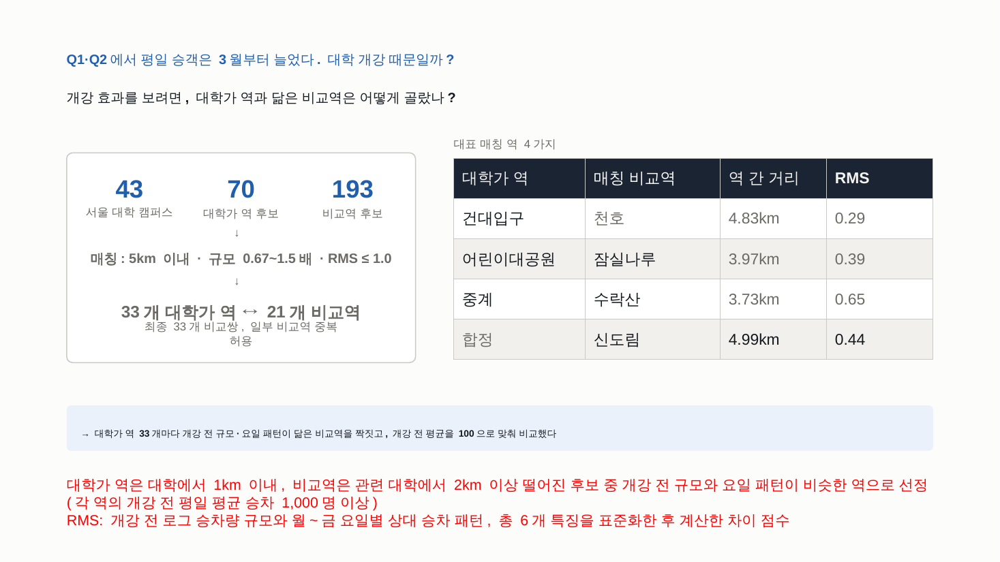 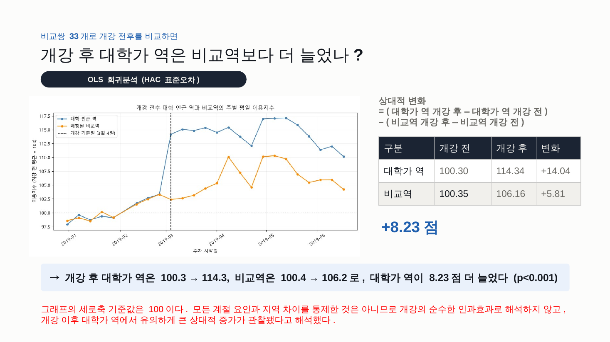 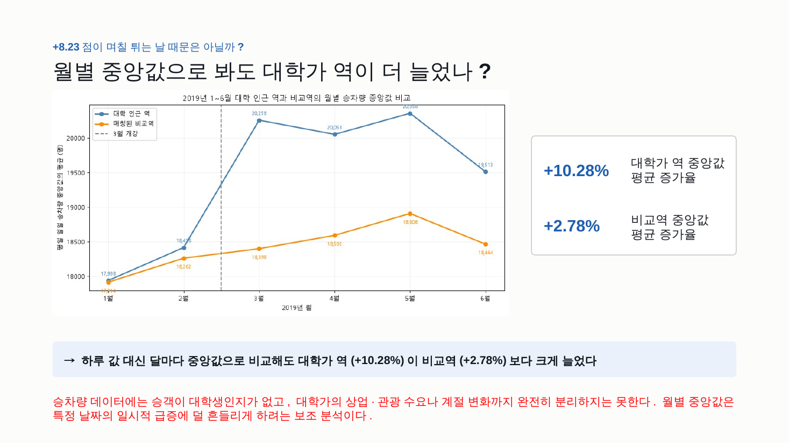
</p>

<p>
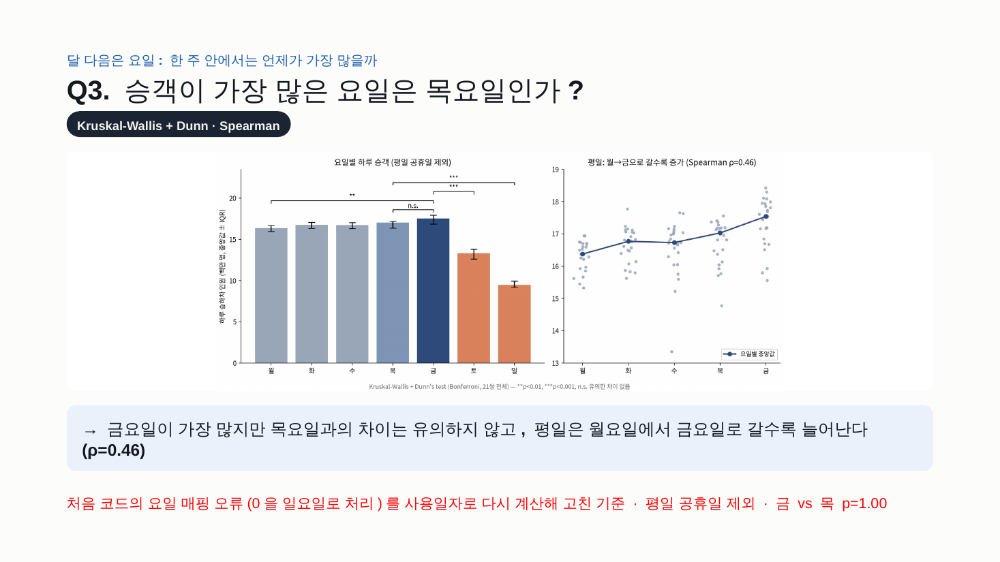 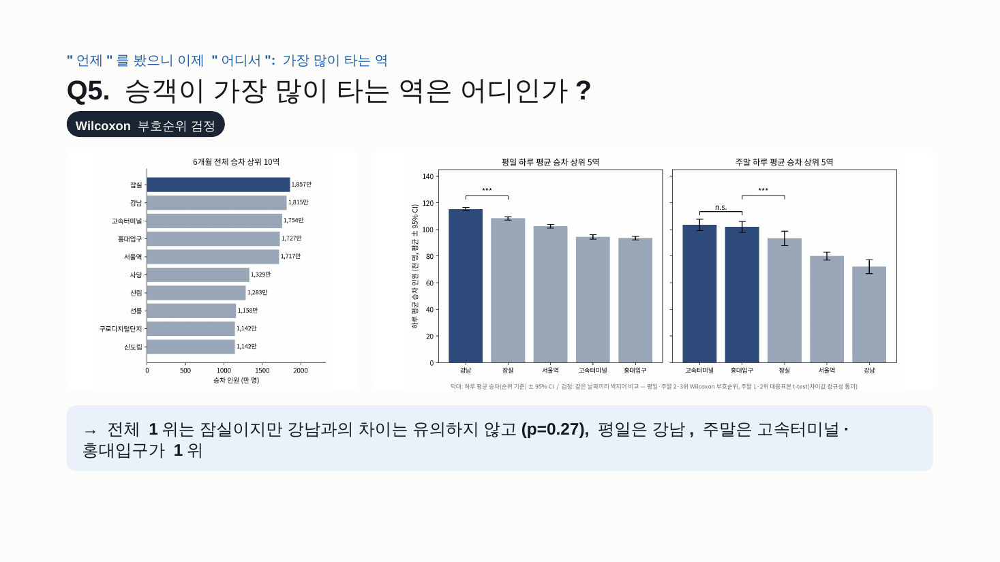
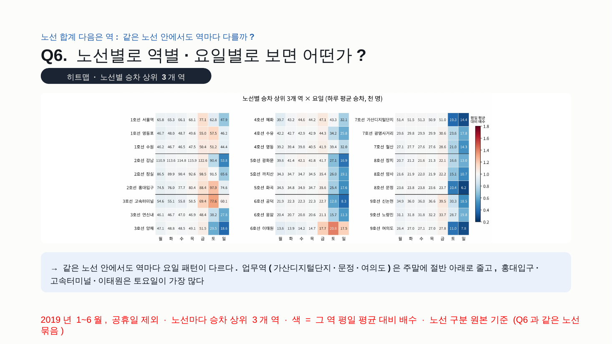 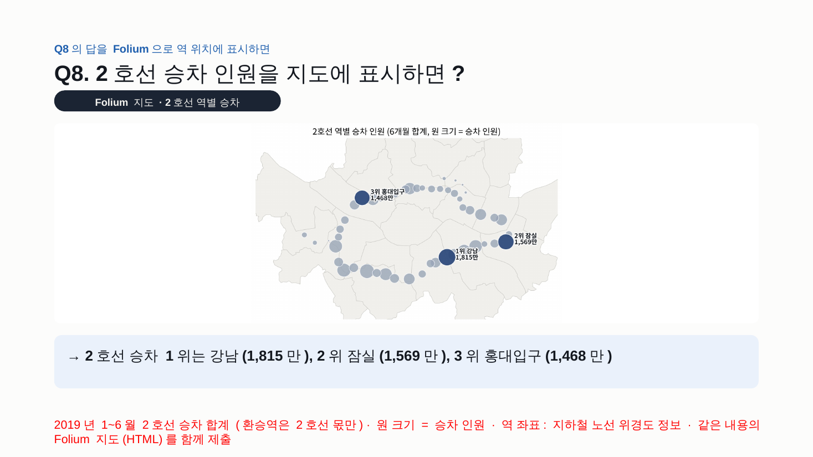
</p>

> **받은 데이터의 한계를 직접 해결한 부분**: 받은 파일은 환승역의 노선이 하나로 합쳐져 있어 Q6\~Q8에 답할 수 없었습니다. 같은 데이터의 공개 원본을 찾아 한 줄씩 대조해 행 수(107,028개)와 승하차 합계가 1명 단위까지 같은 것을 확인한 뒤, 노선이 구분된 원본으로 다시 계산했습니다.

## Part 2 · 평일형 역과 주말형 역

- 대부분 역은 주말에 줄지만 (중앙값 0.66배), 489개 중 27개 역은 주말에 더 붐빈다
- 업무지구는 주말에 크게 줄고, 상업·관광지구는 유지되거나 늘어난다 (Kruskal-Wallis, p<0.001)
- 설 연휴 감소율 63%로 다른 평일 공휴일(42%)보다 크고, 주말 순위와 설 연휴 순위가 일치한다 (ρ=0.56)
- **결론: 주말 ÷ 평일 비율 하나로 역의 성격을 잴 수 있다.** 그렇다면 이 성격은 바뀔 수 있을까?

<p>
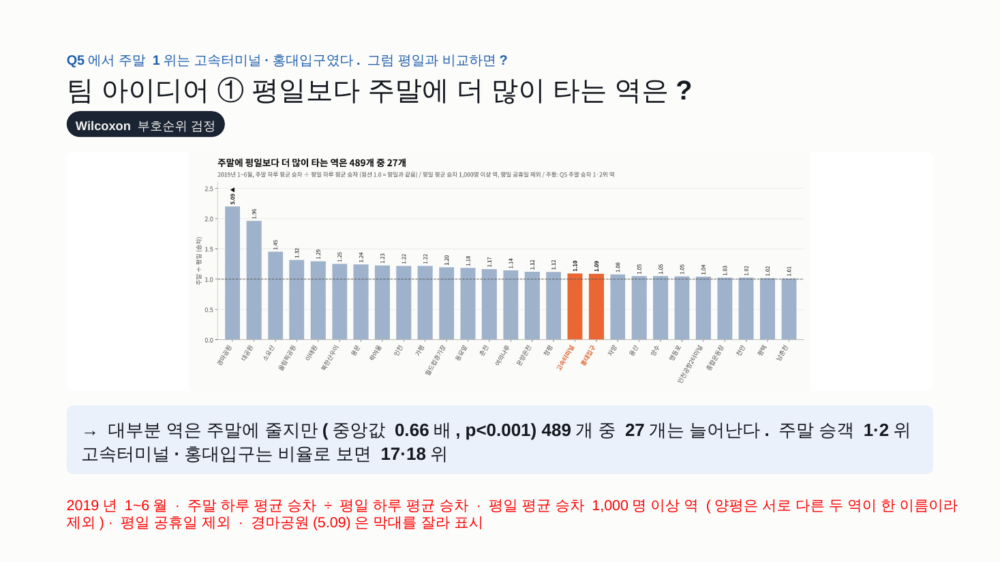 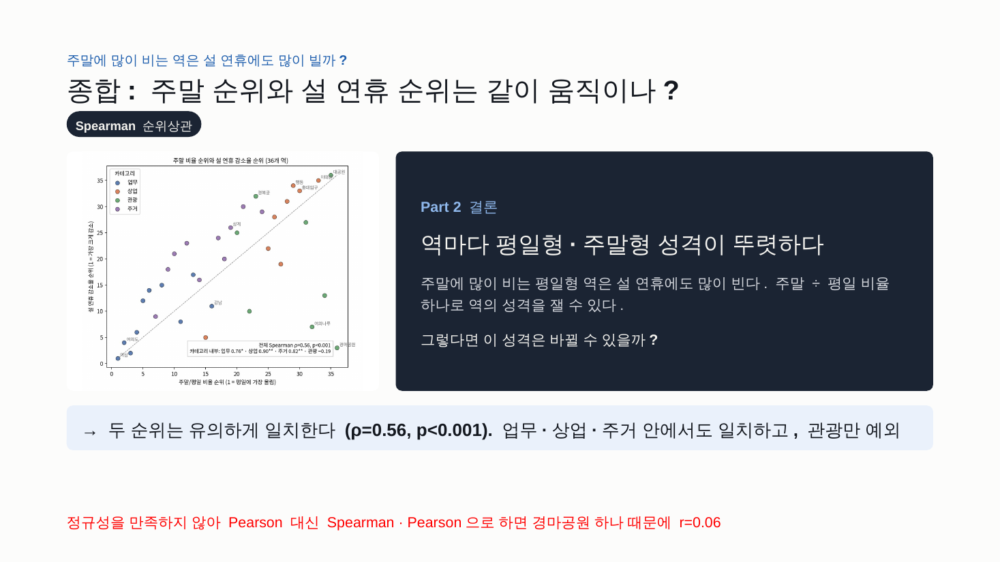
</p>

## Part 3 · 성수, 어디까지 커질까?

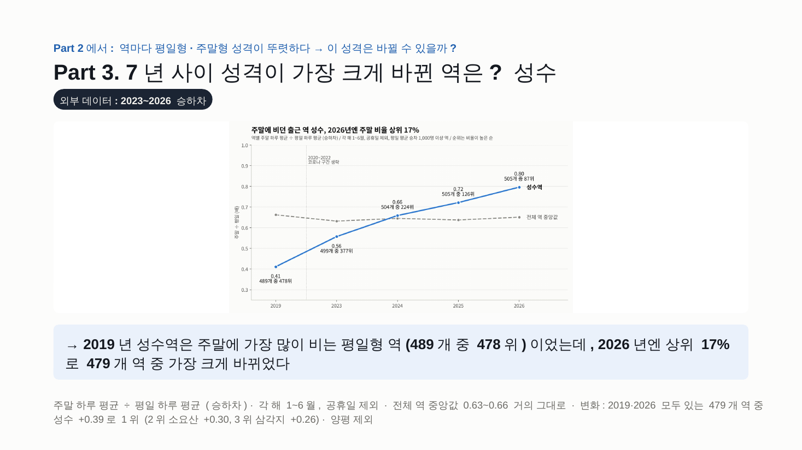

2019년 성수역은 주말에 가장 많이 비는 평일형 역(489개 중 478위)이었지만, 2026년엔 상위 17%로 올라와 **2019·2026 모두 있는 479개 역 중 변화 1위**(+0.39)가 되었습니다.

### 질문 1 · 성수에 오는 사람은 어디서 왔나?

- 성수역 주말 점유율은 2019년의 **3.4배**, 2025년부터는 주말 점유율이 평일을 넘었다
- 성수동엔 서울 전역·서울 밖에서 멀리서 오고 (중앙 이동거리 6.5km), 바로 옆 화양동(건대입구)엔 가까운 성동·광진에서 온다 (4.4km)
- 화양동→성수동 이동 비율은 그대로이고 주변 손님을 뺏은 흔적은 없다 → **성수는 따로 컸다**

<p>
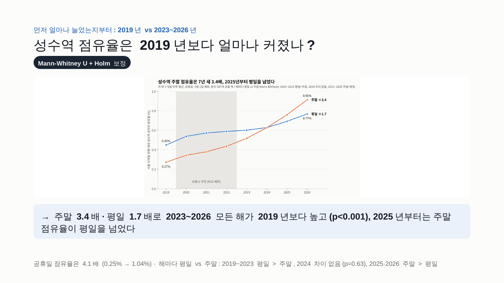 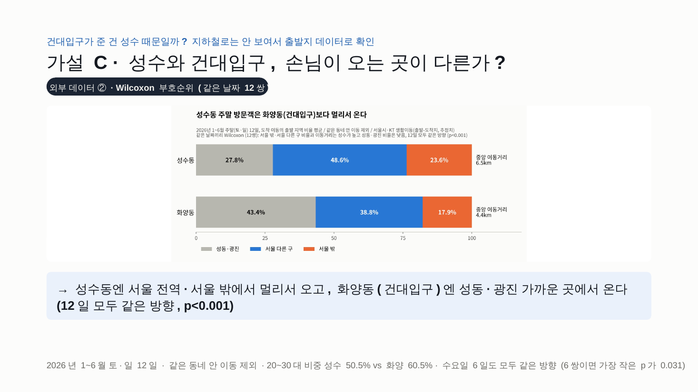
</p>

### 질문 2 · 성수는 아직 크고 있나, 어디로 커지나?

- 같은 달끼리 비교해도 6개 달 모두 2023 < 2024 < 2025 < 2026, 증가 속도도 해마다 +21% 안팎 그대로 → **정점 신호 없음**
- 서울숲·뚝섬 쪽으로 넓어지기보다 **성수역 쪽으로 몰린다** (성수권 안 성수역 비중 45% → 64%)
- 용산·명동으로 옮겨가지도 않았다. 함께 크지만 성수가 더 빠르다 (성수÷용산 0.59 → 0.90)

<p>
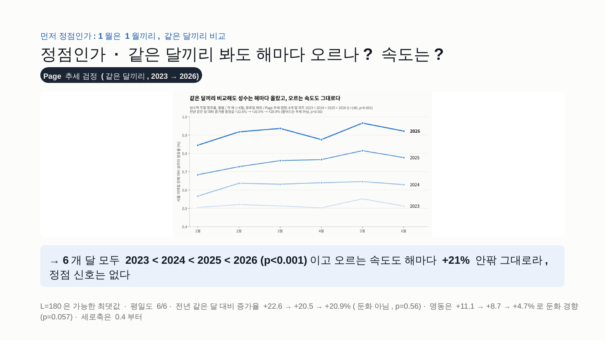 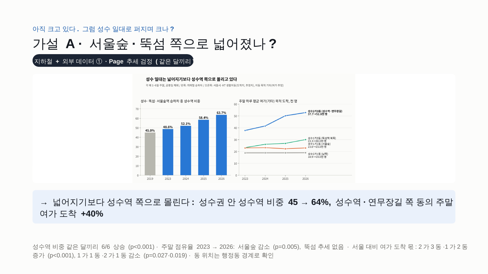
</p>

### 질문 3 · 성수에는 무슨 목적으로, 몇 시에 오나?

- 주말 성수동은 **낮**(10\~16시 도착 56%), 건대입구 쪽은 **저녁**(18\~23시 35%)에 사람이 온다
- 평일 출근 비중은 2026년에도 30.1%로 서울 평균(18.5%)보다 높지만, 그 차이는 해마다 줄고 있다

<p>
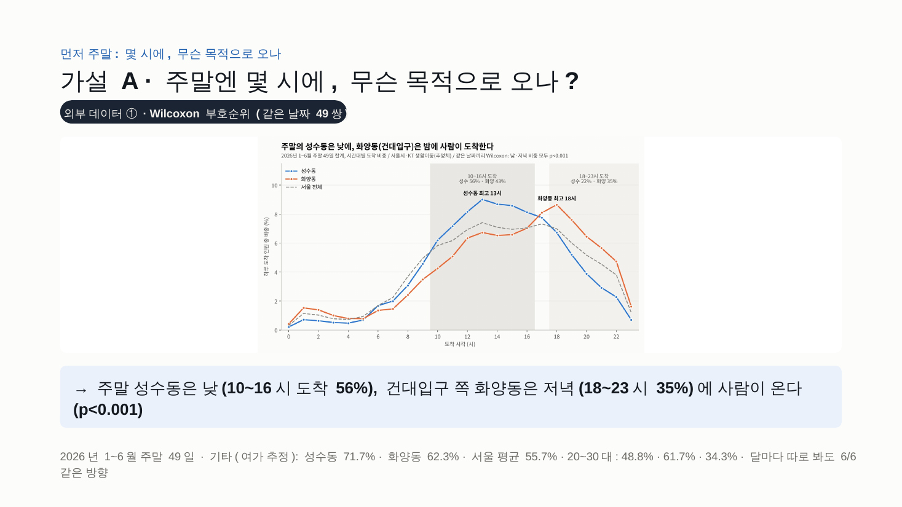 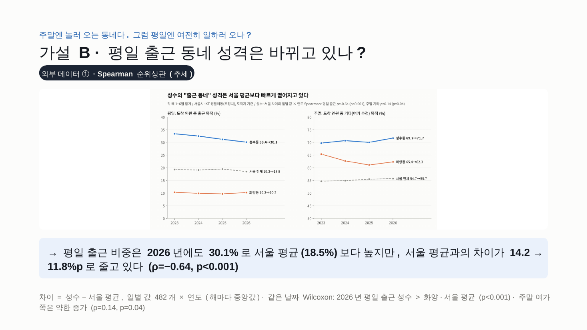
</p>

### 가설 판정 요약

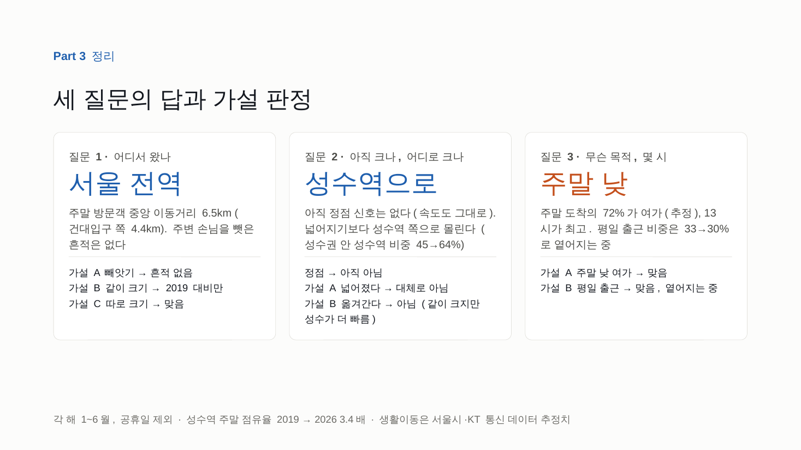

## 활용 제안

분석 결과를 바탕으로 한 제안이며, 효과를 검증한 것은 아닙니다.

- **교통 운영**: 성수동은 주말 도착의 56%가 낮(10\~16시)에 몰리고 성수역 주말 점유율이 평일을 넘었으니, 평일 출퇴근 기준의 배차·출구 운영을 주말 낮까지 넓혀 볼 만하다
- **상권 지표**: 주말 ÷ 평일 비율은 공개 승하차 데이터만으로 매달 계산할 수 있어, '뜨는 동네'를 일찍 찾는 지표로 쓸 수 있다
- **다음 분석**: 성수역 쪽 쏠림이 계속되는지, 연말 성수기(7\~12월)를 더해 다시 확인한다

## 인사이트 · 사람 vs AI

| | 상황 | 배운 것 |
|---|---|---|
| 01 | 예시 코드는 '목요일 1위'를 그려 줬지만 평소 느낌과 달라 AI와 함께 원본 날짜를 대조했고, 요일이 하루씩 밀려 있던 것을 찾아 두 버전을 비교한 뒤 금요일 1위로 정리했다 | 결과가 이상하면 데이터부터 다시 본다 |
| 02 | 질문대로 계산하면 1위는 잠실이었지만, 평일과 주말로 나누자 1위가 강남, 고속터미널·홍대입구로 바뀌었다 | 계산은 AI가 했지만, '나눠 보면 어떨까?'는 사람이 던진 질문이었다 |
| 03 | 받은 파일로는 1호선 1위를 '확정 불가'로 남겼지만, 공개 원본을 찾아 대조하자 답할 수 있었다 | 막혔을 때 원본을 찾아본 게 답이 됐다 |

> AI 덕분에 계산은 빨라졌고, 그만큼 "이게 맞나?"를 따져 볼 시간이 생겼다.

## 재현 코드

[`code/`](code/)의 `run_all.py`로 표와 그림을 다시 만들고, 발표에 쓴 숫자를 결과 파일과 반올림 자리까지 자동 대조합니다.

- Part 1 Q1\~Q5, Part 2: 29개 일치
- Part 1 Q6\~Q8: 85개 일치
- 개강 효과(`p2_개강효과.ipynb`): 캠퍼스 43개, 33쌍, +8.23점, +10.28% / +2.78% 재현
- Part 2 ①, Part 3 성수: 176개 일치

데이터를 받아 두는 위치와 실행 방법은 [code/README.md](code/README.md)에 있습니다.

## 한계

- 1\~6월만 비교해 연말 성수기는 빠져 있다
- 생활이동 데이터는 휴대전화 신호로 추정한 값이고, 이동 목적 중 쇼핑·관광(4·5) 코드가 성수·화양에 없어 '기타'를 여가로 추정했다
- 출발-도착지 데이터는 하루 단위 파일이라 2023·2026년 36일만 표본으로 썼다 (같은 요일 전체와 비교해 대표성 확인)

## 저장소 구성

```
.
├── README.md
├── slides/
│   └── 지하철 이용승객 EDA & 성수, 어디까지 커질까.pdf   # 최종 발표 자료 36장
├── images/                  # README에 쓴 주요 슬라이드
├── map/
│   └── Q8_2호선_folium.html # 2호선 역별 승차 인원 지도
└── code/                    # 재현 코드와 결과(out/)
```
